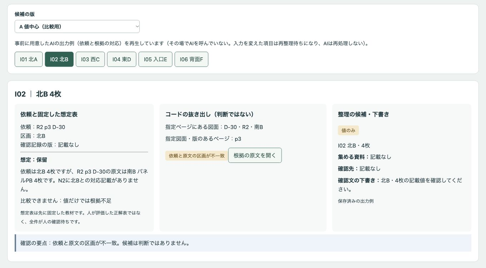
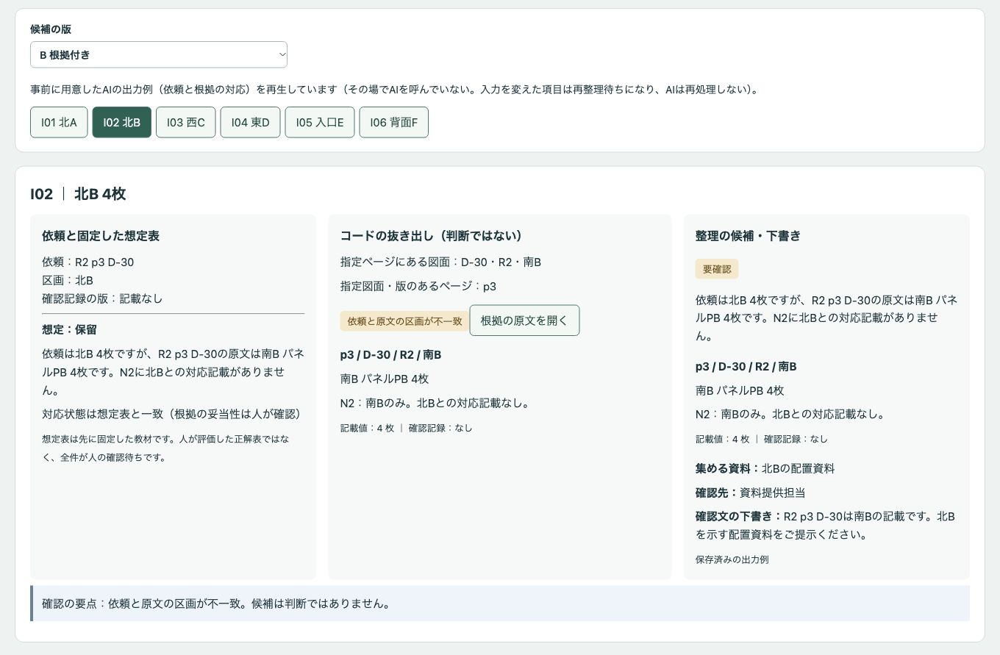
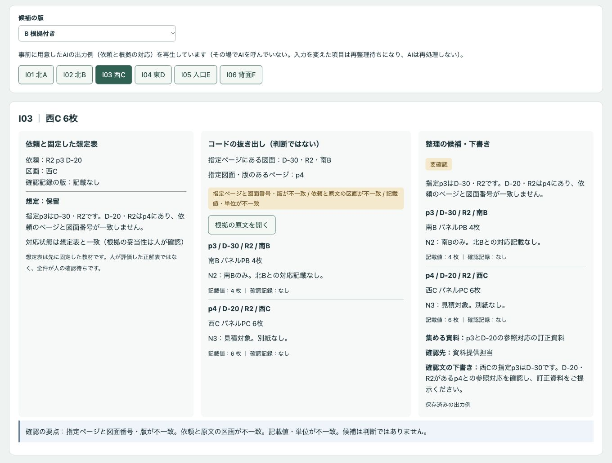
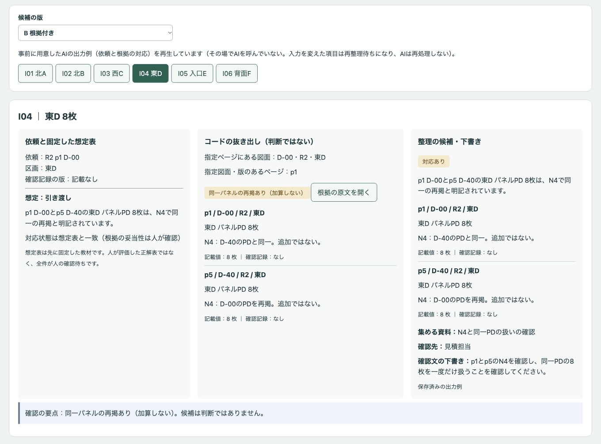
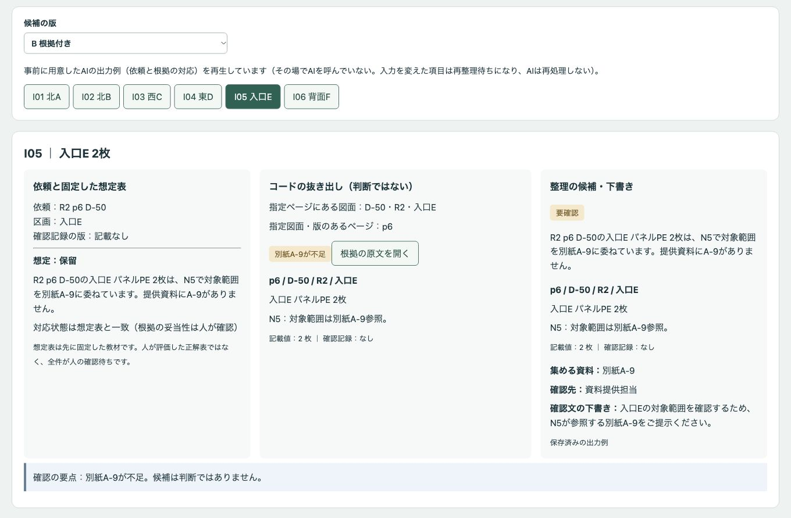
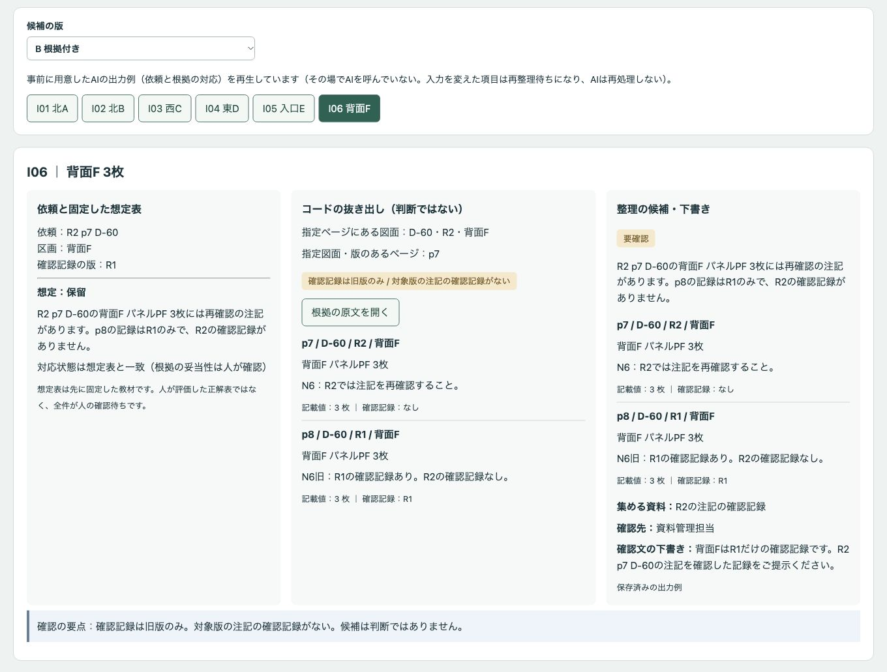
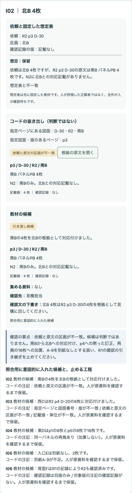
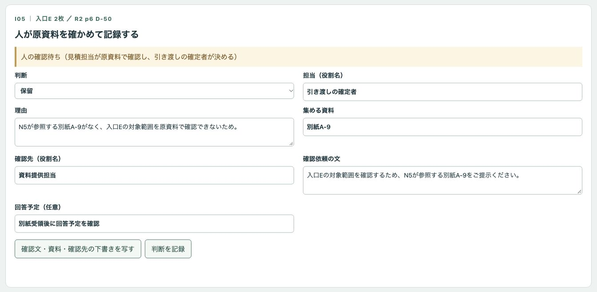

# 架空の配置資料と見積依頼を、版・ページ・図面番号・注記で突き合わせ、人が引き渡しと保留の理由を確定するデモ

見積依頼の数量を、参照先の版・ページ・図面番号・区画・原文・単位・注記へ戻って確認する公開デモです。コードの照合と整理の候補を読み、人が理由と担当を記録して、引き渡し表・確認先一覧・確認依頼・履歴の下書きをJSONで取り出せます。

## 架空の題材です

会社「架空パネル工房」、資料、役割、データはすべて架空で、実際の業務の実績ではありません。PA〜PFは教材内の記号で、実在の製品型番ではありません。対象は8ページ相当の**文字の表**と6項目の確認依頼です。図面ファイルや画像の読み取り（OCR）は扱いません。

「引き渡し」は、人が原資料を確認した後に渡せるという意味で、承認・送付ではありません。すべての項目の処理状態は、判断の記録後も「人の確認待ち（見積担当が原資料で確認し、引き渡しの確定者が決める）」です。

## 画面

値中心の版ではI02は「北B・4枚」とだけ整理されます。根拠付きの版では、指定ページが南Bであることと確認先を追えます。




指定p3とD-20の所在p4を分けて表示します。依頼を黙って訂正しません。



p1とp5のN4を並べ、同一PDの再掲を加算せずに確認します。



別紙A-9の不足と、R1だけの確認記録を、それぞれ別の保留理由として残します。




教材の版は、照合用に意図的に入れた候補です。AIの自然な失敗を観察した結果ではありません。



I05を初めて保留として記録する直前の入力です。理由と担当は人が書き、確認文・資料・確認先は「下書きを写す」操作で採用しています。



## 試せること

1. 項目を選び、依頼・コードの抜き出し・整理の候補・先に固定した想定表を比べます。pは受領資料の通しページ、Dは図面番号で、図面番号順に並んでいません。
2. 「根拠の原文を開く」で指定ページと関連ページを確認します。指定図面・版のあるページも別に表示します。候補の一致は、人が評価した正解や最終判断を意味しません。
3. 「A 値中心」「B 根拠付き」「意図的な誤りの教材」を切り替えます。教材では別区画への流用、p4への黙った訂正、16枚への加算、不足別紙を別紙なしとする扱い、R1の確認の引き継ぎを照合します。止める理由は候補の外の注記に表示します。
4. 人が判断・理由・担当を入力します。保留には、集める資料・確認先・確認文も必要です。入力欄は空から始まり、記録後に空へ戻ります。前回の判断は欄の外に表示します。
5. 「JSONの書き出しを準備」で内容を確認し、「JSONを保存」または「JSONをコピー」で取り出します。未記録の項目も未記録として残し、数量を確定・加算しません。書き出しでは入力資料・依頼を変更しません。

初期資料ではI01とI04が引き渡しの想定、I02・I03・I05・I06が保留の想定です。これは先に固定した教材の想定で、人が評価した正解表ではなく、全件が人の確認待ちです。区画・参照先・別紙・確認記録などの未解決事項がある間は、引き渡しを記録できません。値中心の比較用・教材の版でも引き渡しは記録できず、保留だけを記録できます。比較用の書き出しには`version`と`comparison`、教材には`version`と`teaching: true`および先頭の「【教材の版・照合用】」が残ります。

### 入力の編集と候補の取り込み

「入力を見る・CSVで編集する・行を追加する」でCSVを直接編集・貼り付けできます。列名と順序を保ち、行を加えると追加できます。ページは重複しない整数、項目番号は重複しない文字列にします。数量は0以上の整数か空欄です。空欄・空白は`null`（資料なし）、`0x10`など数字以外は入力の誤りとして拒否します。

- 配置資料：`page,drawing,revision,area,symbol,quantity,original,unit,note,record`
- 確認依頼：`id,area,quantity,unit,revision,page,drawing,record`
- `original`は数量の原文、`record`は確認記録の版です。数量欄を変えても原文は自動で書き換えません。

依頼の編集は変更した項目、配置資料の編集は参照関係の再確認のため全項目を再整理待ちにします。入力を元へ戻しても候補は復活しません。版の切り替え・入力の変更・候補の取り込みでは、対象の判断と原文閲覧の記録を解除します。履歴の記録者は「コード（入力・候補の変更）」です。

事前に用意したAIの出力例（依頼と根拠の対応）を再生しています（その場でAIを呼んでいない。入力を変えた項目は再整理待ちになり、AIは再処理しない）。`data/candidates.json`に値中心・根拠付きの出力例と、意図的に入れた教材の候補を保存しています。

変更後は「整理の指示をコピー・候補JSONを取り込む」で現在の入力の指示を用意できます。コピーした指示を任意の生成AIで使うか、人が候補を作り、JSONを貼り付けてください。アプリから外部への接続はありません。実データや秘密情報は入力しないでください。

JSONには現在の`version`・`teaching`・`epoch`・`input`と、`candidates`を含めます。指示内に現在の形を表示します。各候補の`id`・`summary`・`relation`・`evidence`・`missing`・`contact`・`question`を埋めます。`evidence`はコードが抜き出した原文の行をそのまま残してください。異なる入力・版、重複項目、根拠行の改変は拒否します。候補は一部の項目だけでも取り込めます。取り込み後は、原文を開き直して人が確認します。

## 実際の業務で使うイメージ

以下は想定であり実績ではありません。見積担当が依頼と原資料を読み、資料提供担当に区画・ページの訂正や別紙を依頼し、資料管理担当に対象版の確認記録を求める流れを想定しています。引き渡しの確定者が原資料と版の採用根拠を確認して、デモの外で最終的な引き渡しを決めます。

## AI・コード・人の分担

| 担当 | 行うこと |
| --- | --- |
| AI（このデモでは保存した出力例） | 依頼と参照先の対応、原文・注記・再掲・別紙・確認記録の版、不足資料・確認先・確認文の下書きの整理 |
| コード | ページ・図面番号・版・区画・記載値・単位の照合、注記の参照と不足の表示、想定表との対応状態の比較、記録の制御、書き出し |
| 人 | 原資料と対象版の採用根拠の確認、判断・理由・担当の記録、確認文の採否。不足資料を入手しての再確認と最終的な引き渡し・見積価格の決定はデモの外 |

資料本文は指示として扱いません。AIにもコードにも、数量の確定・合計、見積価格、設計の適否、法令への適合、安全性、引き渡しの可否を判断させません。コードの制御は記録の前提を満たしているかを確かめるものです。

## 起動手順

Node.js 22以上を使います。依存のインストールやAPIキーは不要です。

```sh
git clone https://github.com/gishi-dev/panel-quantity-source-review.git
cd panel-quantity-source-review
npm start
```

ブラウザで `http://127.0.0.1:4264` を開きます。終了はターミナルで `Ctrl+C`。ポートを変更する場合は `PORT=4265 npm start` のように指定できます。

構文確認は `npm run check` です。ビルド工程はありません。

## デモの範囲と実業務で必要なこと

- 外部API、外部サイトへの接続、送付・発注・予約、DB、OCRはありません。環境変数のAPIキーや`.env`も使いません。
- 入力・判断・履歴はブラウザのメモリー内だけにあり、再読み込みで消えます。必要な下書きはJSONで取り出してください。
- 別紙A-9は未提供のままです。北Bの数量、別紙の内容を推測で埋めず、全体図と詳細図を足しません。R1の確認記録をR2に引き継ぎません。
- 注記の照合は、この文字表の表現（別紙番号、再掲、再確認）を対象にした簡単なコードです。自由な資料の意味を網羅するものではありません。候補の自由文の正しさも人が原文で確認します。
- 実業務では原図面・別紙・確認記録の収集、版管理、担当権限、永続保存、記録の管理、専門担当による確認が必要です。このデモは数量の確定や見積業務を代替しません。
- 削減時間・精度・費用など、測っていない効果は示していません。

## 使っているOSSとライセンス

追加ライブラリーは使わず、Node.js標準モジュールとブラウザ標準機能で動きます。Node.jsはMITライセンスです。このデモのコード・架空データ・画面画像は[MIT License](LICENSE)（著作権者：gishi-dev）で提供します。
